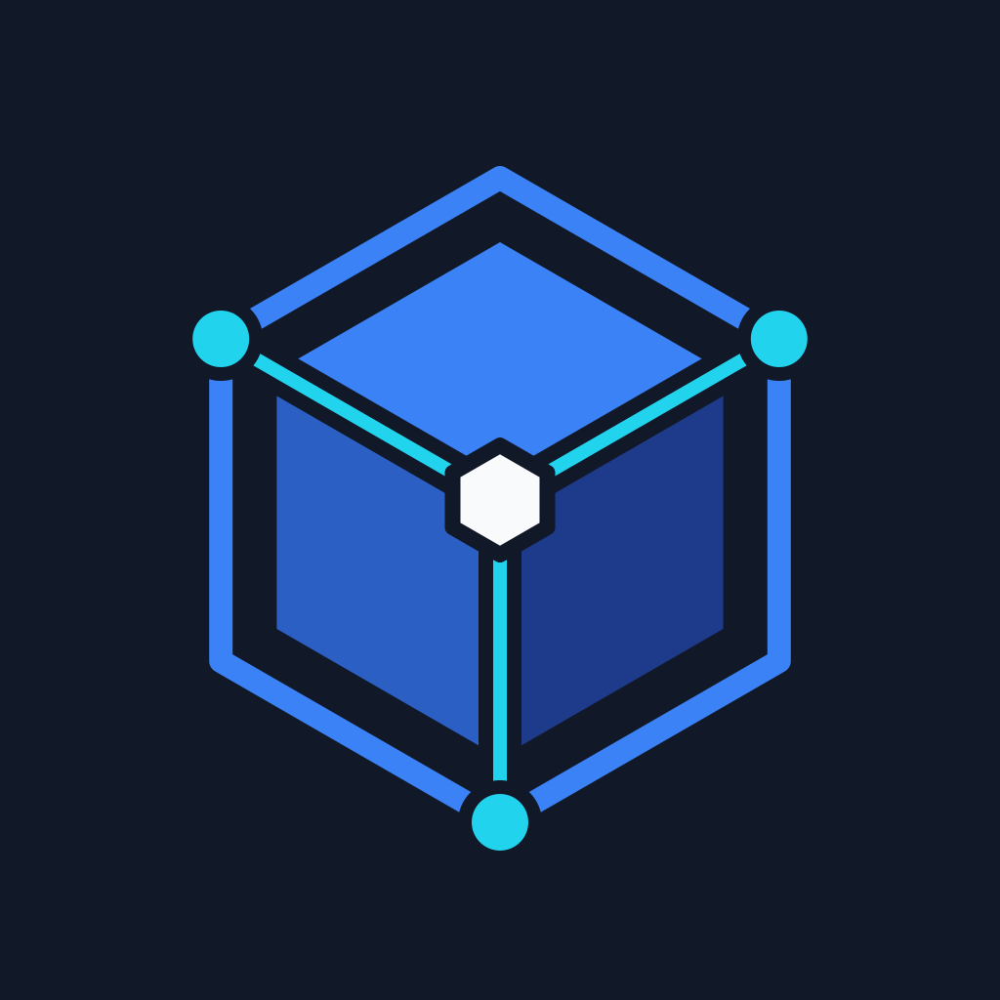
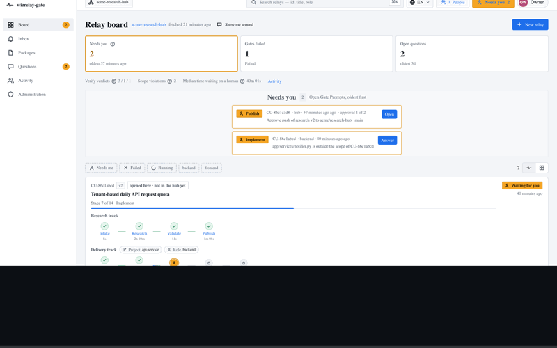

<!-- lang -->
**English** &nbsp;·&nbsp; [Türkçe](README.tr.md)
<!-- /lang -->

#  wizrelay-gate

A local-first dashboard that runs a [wizrelay](https://github.com/ChessWizard/wizrelay)
task as a pipeline of **task quality gates**.

[](LICENSE)
[](package.json)
[](package.json)



wizrelay is a Claude Code plugin: it carries a researcher's task analysis from one team
hub into every developer's AI coding session and enforces it deterministically. It is
driven from slash commands in a terminal.

wizrelay-gate is the other surface for the same work — the way CI/CD turned shell scripts
into stages with quality gates, logs and manual approvals.

```
RESEARCH   Intake ─► Research ─► Validate ─► Publish
                                               │ fan-out per role
DELIVERY   Pull ─► Plan ─► Implement ─► Verify ─► Ship
           └── the question loop can suspend a gate and reopen the research track
```

## What it gives you

- **A pipeline you can see** — nine gates, the research track once and a delivery track
  per role, with the status that needs a person sorted first.
- **A prompt that waits** — when Claude needs a decision, an approval or a file, the gate
  stops and the board says so. Answering continues it.
- **The commands in the open** — every deterministic result shows the command that
  produced it, so the dashboard and the CLI can never silently disagree.
- **Two design directions** — Control Room (dense, dark-first) and Studio (calm,
  light-first), chosen at setup and switchable later. Both in English and Turkish.

## Setting it up

Every step from an empty machine to a working panel, with the stumbling blocks named:
**[Setup, end to end](docs/en/21-walkthrough.md)**. Start there if you are putting this in
front of a team.

## Quick start

```bash
npm install
npm run dev
```

Open <http://localhost:3100>. On the first run the wizard asks for your language, a design
direction and a hub — or hands you the **sample workspace**: seven relays, every gate
state, nothing of yours touched.

## Or run it with Docker

One container is the whole installation — the image carries its own PostgreSQL and applies
its own migrations:

```bash
docker run -d --name wizrelay-gate \
  -p 3100:3100 \
  -v wizrelay-gate-data:/data \
  -e OWNER_EMAIL=you@example.com \
  -e OWNER_PASSWORD='a-long-password' \
  wizrelay/gate:beta
```

Until the first stable release the published tag is `beta`; on a server, pinning a
version is better (`wizrelay/gate:0.1.0-beta.1`).

Nothing to mount and no database to run beside it. Projects are repositories chosen from
the ones your GitHub token can see, and gates run on each person's own machine. Full
details, including how to use your own PostgreSQL:
[17. Running on a server](docs/en/17-docker.md).

## Requirements

| | |
|---|---|
| Node.js | 20.9 or newer |
| git | to read the hub and the project repositories |
| `wizrelay` CLI (Python ≥ 3.9) | optional — to run gates against real repositories |
| Claude Code | optional — for the conversational gates |

Without the optional two, gates play a bundled transcript and the board says so.

## Documentation

**[→ Documentation index](docs/en/README.md)** · one guide, one file per section.

| Start here | |
|---|---|
| [1. Overview](docs/en/01-overview.md) | What it is, and what it is not |
| [4. The nine gates](docs/en/04-gates.md) | The pipeline, the fan-out, the statuses |
| [13. How the code is organised](docs/en/13-architecture.md) | Feature folders and the layering rule |

## Privacy

No account, no server, no telemetry. Nothing leaves your machine except to the git remote
and the tracker you configured yourself. State lives in `.wizrelay-gate/`.

## License

[Apache-2.0](LICENSE)
